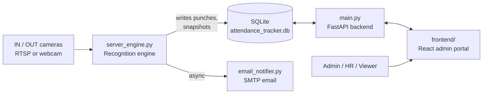

# Attendance Tracker

A face-recognition attendance system for multi-location offices. Cameras at entry (IN) and exit (OUT) gates recognize employees automatically, record the punches in a database, email the employee, and show everything in a role-protected web portal.

---

## 1. How it works (the big picture)



There are **two programs that run side by side**, both sharing the same SQLite database:

| Program | File | Job |
|---|---|---|
| Recognition engine | `server_engine.py` | Reads camera streams, recognizes faces, records attendance |
| Web portal | `main.py` (API) + `frontend/` (React) | Lets people log in, view attendance, enroll employees, manage cameras and users |

---

## 2. The end-to-end flow

### Step 1: Set up people and cameras (one time, via the portal)
1. An **admin** creates logins for portal users (admin / hr / viewer).
2. An **admin or HR** user enrolls each employee: ID, name, email, base location, plus **4 face photos** (front, left, right, slight angle).
3. An **admin** adds cameras and marks each one as strictly `IN` or `OUT` for a given location, as either RTSP (IP camera) or webcam.

### Step 2: Enrollment turns photos into a face "fingerprint"
When photos are uploaded (`POST /api/employees`):
1. InsightFace (`antelopev2` model) detects the largest face in each photo.
2. Each face becomes a **512-number embedding** (a vector).
3. From the front photo, a second copy is made with the lower half of the face masked out, so the person can still be recognized when wearing a mask (eyes-only matching).
4. All vectors are averaged and normalized into one **master embedding** per employee.
5. The employee row, the master embedding (as JSON) and the photos (`enrollment_photos/<EMP_ID>/`) are saved.

### Step 3: Live recognition at the gates
`server_engine.py` runs continuously:
1. Starts **one background thread per active camera** that always keeps the newest frame (avoids RTSP lag).
2. Loops over the cameras, detects every face in the latest frame and computes its embedding.
3. Compares it to every enrolled employee using a dot product (cosine similarity). The best match is accepted if the score is at least `SIMILARITY_THRESHOLD` (default `0.48`).
4. A **cooldown** (default 180 seconds, per employee per camera role) stops the same person being recorded repeatedly while standing in front of the camera.
5. Every 60 seconds it reloads employees and cameras from the database, so new enrollments and camera changes apply **without restarting**.

### Step 4: Turning a recognition into attendance
Each accepted match goes through `process_strict_in_out_event`, which follows the camera's role:

| Situation | What happens |
|---|---|
| First punch of the day on an **IN** camera | Creates the day's row, locks `first_check_in`, saves a snapshot, **sends email** |
| Punch on an **OUT** camera (already checked in) | Updates `last_check_out`, adds elapsed time to `total_working_hours`, **sends email** |
| Punch on an **IN** camera after being OUT (re-entry) | Sets status back to IN, adds elapsed time to `out_of_office_hours`, no email |
| **OUT** punch with no IN earlier that day | Creates a row with status OUT and no check-in (flagged as an unmatched out), sends email |
| Moving to a different location | The new location is appended to `visited_locations` (e.g. `HO -> ICD GARHI`) |

Every punch is also appended to **`attendance_logs`**, the raw audit trail with the match score and snapshot path. The summary table `daily_attendance` holds one row per employee per day.

### Step 5: Viewing and managing in the portal
The React app talks to the FastAPI backend. Pages shown depend on the logged-in role:

| Page | Admin | HR | Viewer |
|---|:-:|:-:|:-:|
| Live Attendance (filters, KPIs, photos, Excel export, auto-refresh every 15 s) | ✅ | ✅ | ✅ |
| Gate Audit Logs | ✅ | ✅ | ✅ |
| Register Employee | ✅ | ✅ | ❌ |
| Cameras | ✅ | ❌ | ❌ |
| User Access (manage logins) | ✅ | ❌ | ❌ |

---

## 3. Project structure

```
AttendanceTracker/
├── server_engine.py     # Live recognition engine (cameras -> attendance)
├── main.py              # FastAPI backend: attendance, logs, employees, cameras APIs
├── auth.py              # Login (bcrypt + JWT cookie) and role-protecting middleware
├── users_api.py         # Admin-only portal user management
├── email_notifier.py    # HTML email with gate snapshot, sent in a background thread pool
├── config.py            # Settings loaded from .env
├── database_setup.py    # Creates the tables (run manually on first setup only)
├── create_admin.py      # CLI to create or reset a portal login
├── portal_app.py        # Older Streamlit portal (replaced by FastAPI + React)
├── enrollment_photos/   # Created automatically: employee photos
├── snapshots/           # Created automatically: gate snapshots by date
└── frontend/            # React + Vite + Tailwind admin portal
    └── src/pages/       # LiveAttendance, AuditLogs, RegisterEmployee, Cameras, Users, Login
```

---

## 4. Database tables

| Table | Purpose |
|---|---|
| `users` | Enrolled employees and their face embedding |
| `cameras` | IN/OUT cameras, location and connection details |
| `attendance_logs` | Immutable raw record of every accepted punch |
| `daily_attendance` | One summary row per employee per day (times, hours, locations) |
| `admin_users` | Portal logins with bcrypt hashes and roles |

---

## 5. Security model

- Passwords are hashed with **bcrypt**; login issues a **JWT in an HttpOnly cookie** valid for 12 hours.
- One middleware protects every `/api`, `/snapshots` and `/photos` request and returns 401 without a valid login.
- Role rules are applied on top: cameras are admin-only, enrollment is admin/HR, and user management is admin-only.
- Secrets (JWT secret, SMTP credentials) live in `.env`, which is git-ignored. The app **refuses to start without `JWT_SECRET`**.
- The API never sends camera passwords back to the browser.

---

## 6. Setup

### Requirements
- Python 3.10+
- Node.js 18+
- A GPU is optional (the engine uses CUDA if available, otherwise CPU)

### Python dependencies
```bash
pip install fastapi uvicorn python-dotenv bcrypt pyjwt pandas openpyxl \
            opencv-python numpy insightface onnxruntime python-multipart
# For GPU: install onnxruntime-gpu instead of onnxruntime
```

### Configure `.env` (project root)
```env
JWT_SECRET=a-long-random-string
DB_PATH=attendance_tracker.db
COOLDOWN_SECONDS=180

SMTP_ENABLED=true
SMTP_SERVER=smtp.gmail.com
SMTP_PORT=587
SENDER_EMAIL=you@example.com
SENDER_PASSWORD=your-16-char-app-password
```
Never commit this file. Set `SMTP_ENABLED=false` to test without sending email.

### First-time setup
```bash
# 1. Create the tables (fresh setup only)
python database_setup.py

# 2. Create your first admin login
python create_admin.py
```
> ⚠️ `database_setup.py` drops and recreates `daily_attendance`, `attendance_logs` and `cameras`. Run it **only once** on a new database. Never run it on a database that holds real attendance data.

---

## 7. Running the system

Open three terminals:

```bash
# Terminal 1: backend API  (docs at http://localhost:8000/docs)
uvicorn main:app --reload --port 8000

# Terminal 2: frontend  (http://localhost:5173)
cd frontend
npm install
npm run dev

# Terminal 3: recognition engine
python server_engine.py        # press 'q' in the preview window to stop
```

Then:
1. Log in at `http://localhost:5173`.
2. Add your cameras (Cameras page).
3. Enroll employees (Register Employee page).
4. The engine picks up new cameras and employees within about 60 seconds.

---

## 8. Configuration reference

| Setting | Where | Default | Meaning |
|---|---|---|---|
| `SIMILARITY_THRESHOLD` | `config.py` | `0.48` | Minimum face match score to accept a person |
| `COOLDOWN_SECONDS` | `.env` | `180` | Ignore repeat detections of the same person on the same camera role |
| `DB_SYNC_INTERVAL` | `config.py` | `60` | Seconds between reloading employees and cameras |
| `LOCATIONS` | `config.py` | HO, ICD sites | Locations offered in the portal dropdowns |

---

## 9. Tech stack

- **Face recognition:** InsightFace (`antelopev2`), OpenCV, NumPy
- **Backend:** FastAPI, SQLite, bcrypt, PyJWT, pandas/openpyxl (Excel export)
- **Frontend:** React, Vite, Tailwind CSS, lucide-react
- **Notifications:** SMTP email with embedded gate snapshot

---

## 10. Known limitations / future work

- No liveness detection, so a photo shown to the camera could be accepted.
- The attendance day is based on the calendar date, so shifts that cross midnight split across two days.
- Cooldown state is kept in memory and resets when the engine restarts.
- Matching loops over all employees; vectorize it for very large headcounts.
- Reports (late arrivals, absentees, monthly summaries) are not built yet.
